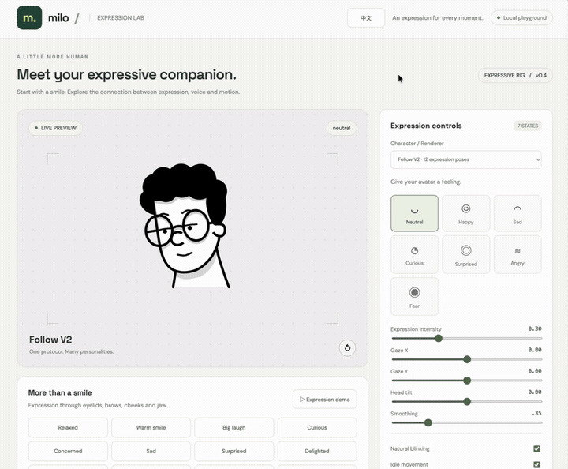
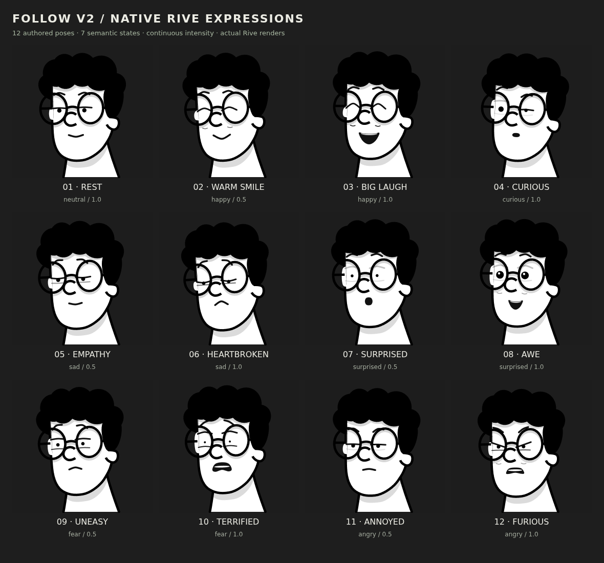
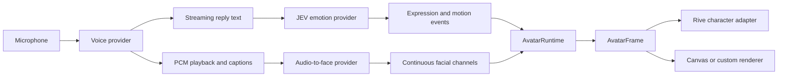

# Milos

[](https://github.com/gao288/Milos/actions/workflows/ci.yml)

**An expressive avatar framework for real-time voice conversations.**

Milos connects streaming speech, emotion inference, and continuous facial animation through a shared, renderer-independent interface. Swap the character, animation engine, or voice provider while keeping the same control protocol.

## Demo

[](https://gao288.github.io/Milos/)

**[Watch the full demo with sound (67 seconds)](https://gao288.github.io/Milos/)** · The preview above is a silent, 16-second excerpt.

## Expressions



*Native Follow V2 expressions, adapted from [Interactive Character Follow](https://rive.app/marketplace/28334-53514-interactive-character-follow/) by alinazari, licensed under CC BY 4.0.*

## Features

- **Stateful expressions:** seven emotion states, including fear, with twelve authored Follow V2 variations and smooth native Rive transitions.
- **Continuous articulation:** 27 mouth channels drive upper and lower lips, independent mouth corners, and jaw geometry. An optional UniTalker ONNX provider converts audio into facial performance frames.
- **Voice conversations:** GPT-Live, experimental ElevenLabs revoicing, and experimental Speech Engine with a separate streaming language model.
- **Text-driven emotion:** JEV reads reply text and recent context to suggest emotion, intensity, head tilt, and gestures. Live output is inspectable in the UI.
- **Natural motion:** breathing, blinking, gaze, idle head movement, and interruptible gestures.
- **Interchangeable renderers:** Follow, Girl, and Milo Rive characters plus a Canvas example; expressions and speech share the same runtime contract.
- **English / 中文 interface:** instant switching with a remembered preference. English and Mandarin speech samples are included.

The project is a working development playground and reusable source framework. Voice integrations are experimental; it is not yet a published npm package or a production multi-user service.

### Girl character

The character selector also includes **Girl · 12 expression poses**, adapted from
[marvin.te’s Girl Animation (Cursor Tracking)](https://rive.app/marketplace/19397-36522-girl-animation-cursor-tracking/).
It uses the same expression, motion, and continuous mouth protocol, so character
switches preserve the current performance. Its original facial artwork is animated
through controller keyframes and lip-bone offsets. Choose Girl from the dropdown, or use
`?character=girl` in the app URL.

[View the native expression sheet](design/expression-studies/girl/v1-rendered.png)
· [Download the Rive Editor project](public/girl-expressive.rev)

## Quick start

Use **Node.js 22.12 or later** and npm.

```sh
git clone https://github.com/gao288/Milos.git
cd Milos
npm ci
npm run dev
```

Open [localhost:5173](http://localhost:5173). Try the expression presets, mouth controls, character switcher, and text input. The animation playground needs **no API keys, model download, or Rive account**; compiled animations, fonts, and Rive WASM are included in the project dependencies/assets.

Voice chat and audio-to-face inference are optional services. Follow the [setup guide](docs/setup.md) to enable them. A microphone requires localhost or HTTPS.

## How it works



The playback clock anchors captions and facial performance. Expression, articulation, and body motion are independent channels, so an emotion change does not interrupt speech. Each character adapter maps normalized inputs to its own geometry and state machine.

JEV checks for new reply text about every 500 ms, with at most one request in flight. That is a scheduling interval, not an end-to-end latency guarantee. Audio continues if emotion or mouth inference arrives late.

## Voice modes

| Mode | Conversation and speech pipeline | Status |
| --- | --- | --- |
| GPT-Live | Native bidirectional voice, streamed audio and transcript | Integrated |
| ElevenLabs revoicing | GPT-Live reply text → phrase synthesis with ElevenLabs | Experimental; additional buffering and usage from both services |
| Speech Engine | ElevenLabs recognition and turn handling → streaming OpenAI text → ElevenLabs streaming speech | Experimental; requires a public authenticated callback |

Provider models and voices are configurable through server-side environment variables. Available models depend on your provider account. See [configuration and setup](docs/setup.md) and [deployment](docs/deployment.md).

## Control the avatar

In the running app, use the browser console:

```js
window.avatar.dispatch({ type: "expression", emotion: "fear", intensity: 0.8 });
window.avatar.dispatch({ type: "motion", headTilt: 0.15, durationMs: 1800 });
window.avatar.dispatch({ type: "gesture", name: "nod" });

// Switching characters preserves the framework's control state.
await window.avatar.setCharacter("milo");
```

The standalone runtime can also consume timestamped facial channels from your own model:

```js
import { AvatarRuntime, PerformanceTimeline } from "./src/framework/index.js";
import { RiveAdapter } from "./src/adapters/rive.js";
import { interactiveFollow } from "./src/characters/interactive-follow.js";

// host: a positioned DOM element with explicit width and height.
// audio: an HTMLAudioElement whose playback matches the performance clip.
const runtime = new AvatarRuntime();
await runtime.setRenderer(new RiveAdapter(interactiveFollow), host);
const clip = new PerformanceTimeline({
  schema: "arkit-52-v1",
  durationMs: 1000,
  frames: [
    { timeMs: 0, weights: { jawOpen: 0 } },
    { timeMs: 500, weights: { jawOpen: 0.6, mouthFunnel: 0.3 } },
    { timeMs: 1000, weights: { jawOpen: 0 } },
  ],
});
runtime.setPerformance(clip, () => audio.currentTime * 1000);

let raf;
function tick(now) {
  runtime.update(now);
  raf = requestAnimationFrame(tick);
}
raf = requestAnimationFrame(tick);
// On unmount: cancelAnimationFrame(raf); runtime.dispose();
```

See the [framework and animation guide](docs/architecture.md) and [TypeScript interface declarations](src/framework/index.d.ts) for renderer lifecycles, events, streaming performance, and Rive authoring.

## Development

```sh
npm test                         # Runtime, geometry, and voice scheduling tests
npx playwright install chromium # One-time browser installation
npm run test:browser             # Browser integration tests; mocked voice services
npm run build                   # Production assets in dist/
```

The browser suite uses a simulated microphone and does not require paid API calls. Optional Python provider tests run with `npm run test:model` after model environment setup. See [CONTRIBUTING.md](CONTRIBUTING.md) for the development workflow.

| Directory | Purpose |
| --- | --- |
| `src/framework/` | Normalized events, runtime, motion, and performance timelines |
| `src/adapters/`, `src/characters/` | Renderers and character-specific mappings |
| `src/voice/` | Playback, interruption, captions, and emotion scheduling |
| `server/` | Voice proxy, JEV, Speech Engine callback, and ONNX inference |
| `rive/`, `rive-follow/` | Editable animation sources |
| `scripts/` | Animation builds, model installation, and resource setup |
| `tests/` | Unit and browser coverage |

## Current boundaries

- UniTalker supplies 51 named channels; the `arkit-52-v1` interface fills the missing `tongueOut` channel with zero. Each rig supports its own mapped subset. This is not NVIDIA Audio2Face, and no model was trained for this project.
- Streaming mouth inference uses overlapping audio windows. Timestamp precision, network delay, device echo, and very quiet speech can affect synchronization. Word-perfect alignment is not guaranteed.
- The text-only and microphone vowel demos are heuristic fallbacks, not phoneme recognizers. Voice modes use audio-derived continuous mouth control.
- Head tilt from JEV is a semantic gesture suggestion, not measured head-pose prediction.
- Local Codex task delegation is planned; the app does not currently execute delegated tasks.

## License and attribution

Project code is licensed under [ISC](LICENSE). Character artwork, model-related resources, and other third-party components retain their respective terms; see [THIRD_PARTY_NOTICES.md](THIRD_PARTY_NOTICES.md). Model weights are downloaded separately and are not included in this repository.

Milos is an independent project and is not affiliated with Rive, OpenAI, ElevenLabs, or the original character creator.
